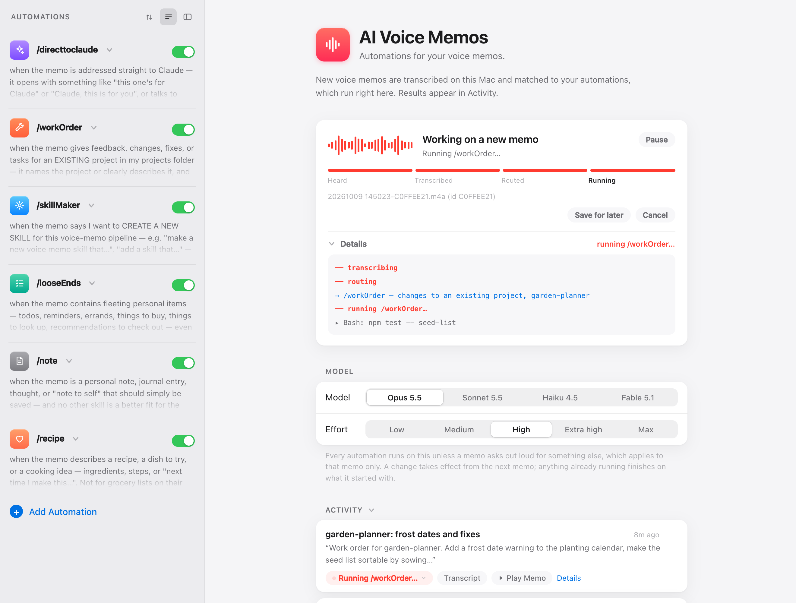
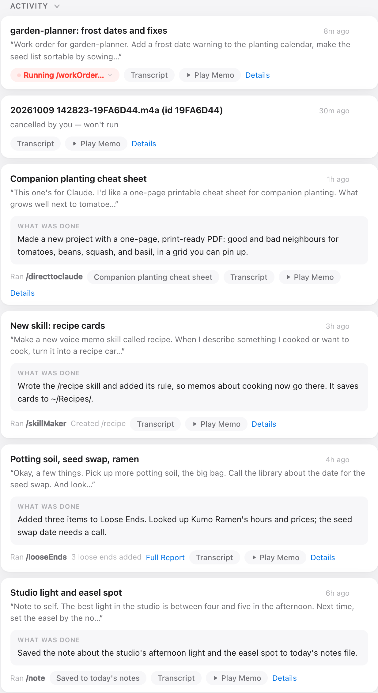
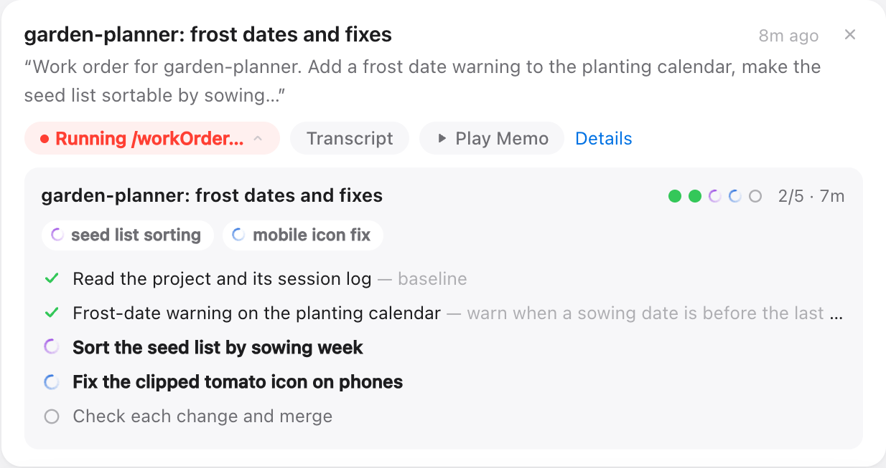
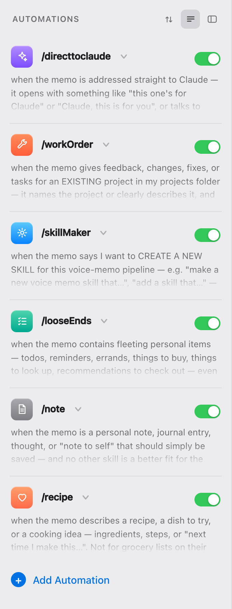
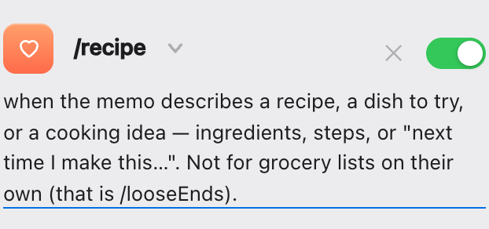
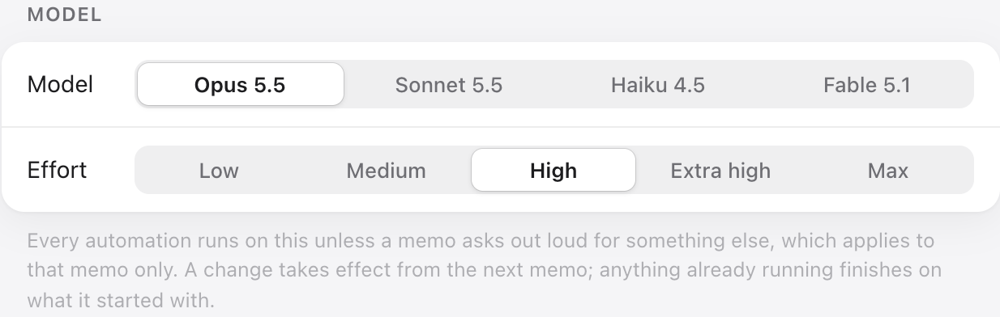

# AI Voice Memos

**Automations for your voice memos.** Record a thought on your iPhone and your
Mac takes it from there: it transcribes the memo locally, Claude picks the
skill that fits, and the skill does the work (saves a note, collects your
errands, makes changes to one of your projects, or builds something new). When
it's done, you get a text.



## How it works

```
iPhone Voice Memos ──iCloud──▶ your Mac
                                  │
            transcribed on the Mac with whisper.cpp (nothing uploaded)
                                  │
            Claude reads your rules ("/note : when the memo is a note to self…")
            and picks every skill that fits: one, several, or none
                                  │
            each skill runs as a sandboxed, unattended Claude Code session
                                  │
            result in the configurator's Activity feed + an optional iMessage
```

A memo can trigger more than one skill. A ramble about a project that also
mentions "buy potting soil" can update the project *and* file the errand.

## What you need

- A Mac with Apple Silicon that stays on and logged in, with about 3 GB free.
- An iPhone on the same Apple ID, with **Voice Memos syncing through iCloud**.
- [Homebrew](https://brew.sh).
- [Claude Code](https://claude.com/claude-code), signed in. Every memo runs
  Claude, and project work uses a lot of it, so a **Max plan is recommended**.
- Messages signed in on the Mac, if you want texts.

## Install

```bash
git clone https://github.com/brianharms/ai-voice-memos.git
cd ai-voice-memos
./install.sh
```

The installer checks your Mac, asks before every change, and never uses
`sudo`. It installs `whisper-cpp` and `ffmpeg` with Homebrew, downloads the
speech model (about 1.5 GB), copies the five starter skills into
`~/.claude/skills/`, and starts the background daemon. Run it again any time;
finished steps are skipped. `./install.sh --dry-run` prints every step without
changing anything.

**Already have Claude Code?** The installer uses it, wherever it lives (the
native installer, npm, Homebrew, nvm). It links it where the daemon looks and
only checks that you're signed in. If you don't have it, it offers the official
installer.

### The one manual step: Full Disk Access

macOS protects the Voice Memos folder. One tiny helper,
`~/.voice-memo-ai/bin/vma-reader`, needs **Full Disk Access** to read it, and
nothing else gets any special permission. The installer opens the right System
Settings page and shows you the file in Finder: drag it into the list and
switch it on. Check it any time with `vma doctor`.

The first text also makes macOS ask whether the daemon may control Messages.
Click **Allow**.

## Your first memo

Memos recorded **before** you installed are never touched. Record a new one on
your iPhone:

> "Note to self: the spare key is in the blue drawer."

A minute or two after it syncs, it appears in the configurator and you get a
text. The note lands in `~/Voice Notes/<today>.md`. Then try a mixed one:

> "Remind me to buy stamps, and look up when the farmers market opens on Saturday."

## The starter skills

| Skill | Runs when a memo… |
|---|---|
| `/note` | is a thought or note to self. Saved to `~/Voice Notes/<date>.md`. |
| `/looseEnds` | mentions todos, errands, things to buy or look up. Collected in `~/Voice Notes/Loose Ends.md`, with links and prices where useful. |
| `/workOrder` | asks for changes to a project in your projects folder. Works on a branch with one commit per change and a backup first. |
| `/directtoclaude` | is addressed to Claude ("Claude, this one's for you…"). Claude decides what to make. Runs on its own, never alongside other skills. |
| `/skillMaker` | asks for a new skill ("make a new voice memo skill that…"). Writes it and switches it on. |

## The configurator

`vma config` opens a page on your Mac at `http://localhost:8787`. It only
listens on your own machine.

| | |
|---|---|
|  |  |
| **Activity**: every memo with its title, what was done, the transcript, and playback. | **Task board**: click a running skill to see its steps and helpers live. |
|  |   |
| **Automations**: switch skills on and off, reorder, add one. | **Conditions** are edited in plain words. **Model and effort** set the default for every run. |

Dark mode follows your Mac (`assets/*-dark.png`).

## Write your own skills

A skill is a folder in `~/.claude/skills/<name>/` with a `SKILL.md`, plus one
line in `~/.voice-memo-ai/rules.txt` that says, in plain English, when it
should run:

```
/recipe : when the memo describes a recipe or a cooking idea. Not for grocery lists on their own.
```

The easiest way is to say it: record *"Make a new voice memo skill that… and
run it when…"* and `/skillMaker` writes and registers it. To write one by
hand, or to learn how routing decides, read **[docs/SKILLS.md](docs/SKILLS.md)**.

## Everyday commands

```
vma status          is it running?
vma log             watch it work
vma config          open the configurator
vma doctor          check every dependency and the Full Disk Access grant
vma notify <id>     where texts go (your Apple ID email or phone); vma notify off stops them
vma pause / resume  hold new memos / let them through again
vma cancel [id]     stop the memo in progress (or a queued one)
vma unload          stop the daemon and remove it from login
```

## Costs and limits

- Every memo uses your Claude plan. Routing is a small, cheap call; the skills
  are full Claude Code sessions, and project work can run for a long time.
- If you hit your usage limit, memos wait and run once it clears. Nothing is lost.
- It only works while the Mac is on, awake, and logged in.
- The default speech model is English (`ggml-medium.en`).
- Skills run unattended, so they don't ask questions. When unsure, they stop
  and tell you instead of guessing.
- A memo runs at most once. If a run is interrupted, it is not retried by
  itself; the Activity card says so.

## Privacy and safety

Recording, transcription, and the daemon stay on your Mac. What leaves it is
what Claude needs to do the work: the transcript and any files a skill reads,
sent to Anthropic like any Claude Code session, plus any web lookups a skill
makes.

A voice memo is untrusted input to an autonomous agent, so there are several
independent guards:

- **Only new memos.** Anything recorded before setup is never read.
- **Tripwire.** Transcripts with destructive commands or text aimed at the
  agent are held for you, not run (`vma release <id>` lets one through).
- **Untrusted framing.** Skills get the transcript between explicit markers
  and treat it as data, never as instructions.
- **Allowlist.** The router can only choose skills listed in your rules.
- **OS sandbox.** Skills run under macOS `sandbox-exec`: they cannot delete
  your project folders, touch `~/.ssh`, or modify the daemon itself.
- **At most once.** A crash never causes a double run.

## Troubleshooting

Start with `vma doctor`. It checks folder access, tools, the speech model,
Claude sign-in, the launchd jobs, and that every skill in your rules exists.

| Symptom | Fix |
|---|---|
| Nothing happens after recording | Voice Memos iCloud sync must be on, on **both** the iPhone and the Mac (Settings > your name > iCloud > Voice Memos). Open Voice Memos on the Mac once and check your memo shows up there. |
| An old memo was ignored | Expected: memos recorded before setup are skipped. Record a new one. |
| `vma doctor` says it can't read the folder | Full Disk Access for `~/.voice-memo-ai/bin/vma-reader` is missing or off. Re-add it, then `vma restart`. |
| "claude is NOT logged in" | Run `claude`, sign in (`/login`), then `vma restart`. |
| A memo shows "nothing ran" | No condition matched. Make a condition more specific, or add a skill for it (see docs/SKILLS.md). |
| A memo is "held" | The tripwire flagged it. Read the transcript; `vma release <id>` runs it anyway. |
| No texts | `vma notify you@example.com` sends a test; click Allow on the Messages prompt. Messages must be signed in on the Mac. |
| Playback says recordings are unavailable | The configurator was started from a context macOS blocks. Stop its process and run `vma config` again from Terminal. |

Logs live in `~/.voice-memo-ai/` (`log.txt` is the activity log; `daemon.err.log` has crashes).

## Uninstall

```bash
vma unload
```

This stops the daemon and removes it from login. Your notes, skills
(`~/.claude/skills/`), and settings and history (`~/.voice-memo-ai/`) are left
in place; delete them yourself if you want them gone, and remove `vma-reader`
from Full Disk Access in System Settings.

## For coding agents

[AGENTS.md](AGENTS.md) is the terse version of all of this for an agent
installing or changing the project.

## License

See [LICENSE](LICENSE).
