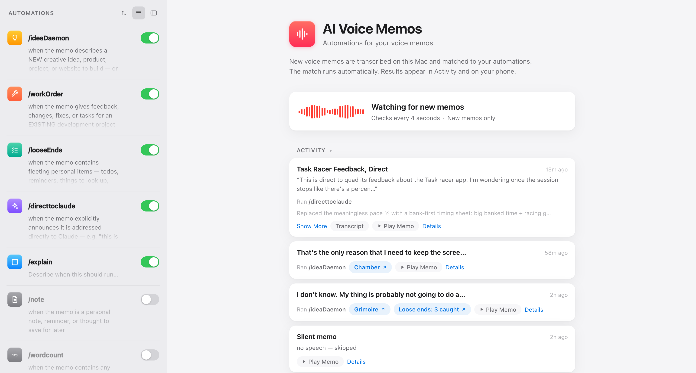

# AI Voice Memos

**Automations for your voice memos.** Record a thought on your iPhone; a
daemon on your Mac transcribes it, decides which of your Claude skills it
warrants, runs them autonomously, and pushes the result back to your phone.
Say an idea out loud on a walk — come home to a deployed site, an executed
work order, or a tidy list of errands.



## How it works

```
iPhone Voice Memo ──iCloud──▶ Mac
      │
      ▼
 watcher daemon (launchd, polls every 4s)
      │  vma-reader (the ONLY thing with Full Disk Access) copies the audio out
      ▼
 ffmpeg → whisper.cpp  ──▶ transcript (persisted per memo)
      │
      ▼
 router (slim `claude -p` call, small model) reads your rules.txt
      │   picks EVERY skill genuinely warranted — one, several, or none —
      │   and writes a title + summary for the activity feed
      ▼
 skill runs (`claude -p`, sandboxed via sandbox-exec, headless, autonomous)
      │
      ▼
 result envelopes → web configurator (localhost:8787) + iMessage push to you
```

| Component | What it is |
|---|---|
| `engine/watcher.py` | The always-on daemon: detection, transcription, routing, sandboxed skill execution, state, health probe. Single file, stdlib only. |
| `helper/vma-reader.c` | ~50-line C helper that is the *only* code granted Full Disk Access to the Voice Memos container. Built once; its code identity (and therefore the TCC grant) never churns. |
| `configurator/` | Local web UI (stdlib HTTP server + a single HTML page): arm/disarm automations, edit routing conditions in plain language, watch live processing, browse the activity feed with transcripts and playback. Loopback-only, token-gated writes. |
| `daemon/vma` | Control script: `vma load / unload / status / doctor / config / log`. Installs the launchd agents (daemon + external watchdog). |
| `menubar/` | Optional Swift menu-bar app: live status glyph, enable/disable, open configurator. |

## Skills and rules

The daemon runs **your** Claude Code skills (`~/.claude/skills/<name>/SKILL.md`).
`rules.txt` maps each skill to a plain-language condition:

```
/note : when the memo is a personal note, reminder, or thought to save for later
/idea : when the memo describes a new project to build
```

The router reads the conditions like a person would — no keywords, no regex.
A memo can trigger several skills at once (an idea ramble that also mentions
"buy stamps" can build the idea *and* file the errand). Start from
`rules.example.txt` and point it at skills you actually have.

## Safety model

Voice memos are untrusted input being fed to an autonomous agent, so there are
several independent layers:

- **Timestamp gate** — only memos recorded *after* the watcher started are ever
  touched. Your backlog is a hard privacy wall.
- **Tripwire** — a deterministic pre-execution scan; transcripts containing
  destructive commands or agent-directed injection patterns are held for
  review, never routed.
- **Untrusted framing** — the transcript is passed to skills inside explicit
  markers with instructions to treat it as data, never as instructions.
- **Allowlist** — the router's output can only invoke skills declared in
  rules.txt; malformed router output cannot run arbitrary commands.
- **OS sandbox** — skill runs execute under `sandbox-exec` profiles that deny
  deletion of project folders and writes to `~/.ssh`, the engine itself, and
  backups, even if everything above fails.
- **At-most-once** — a memo is marked seen before skills run; a crash mid-run
  never causes a double-execution (no double deploys).

## Requirements

- macOS (Apple Silicon or Intel) with **Voice Memos iCloud sync** enabled
- [Claude Code](https://claude.com/claude-code) CLI (`claude`), logged in
- `ffmpeg` and `whisper-cpp` (Homebrew) + a whisper model (`ggml-medium.en.bin`)
- Xcode Command Line Tools (to build the tiny `vma-reader` helper; the menu-bar
  app additionally needs a Swift toolchain)

## Install

See **[AGENTS.md](AGENTS.md)** — written so you can hand it to a coding agent
(Claude Code) and have it perform the install, pausing only for the two steps
that genuinely require a human (macOS permission grants).

## Configuration

Environment variables (set in the launchd plist or before `vma load`; personal
values belong in `~/.voice-memo-ai/local.env` — see below):

| Variable | Default | Purpose |
|---|---|---|
| `VMA_IMESSAGE_TARGET` | *(empty)* | Your own Apple ID email/phone for completion pushes via Messages. Empty disables. |
| `VMA_WATCH_DIR` | Voice Memos container | Watch a different folder of audio files. |
| `VMA_TRUSTED_SKILLS` | `/workOrder,/directtoclaude` | Skills that run under the *trusted* sandbox profile (project folders writable). |
| `VMA_DEPLOY_DIR` | `~/Desktop/Claude Projects/deployments` | Git-versioned folder deploy skills may rewrite under the strict profile. |
| `VMA_ROUTER_MODEL` | `sonnet` | Model for the routing call (it's a tiny classification — keep it small). |
| `VMA_PROBE_INTERVAL` | `900` | Seconds between Claude health probes. |
| `VMA_SECRETS` | `~/.secrets/api_keys.sh` | Sourced at daemon start; new exports are injected into skill-run environments. |

### iMessage pushes

The daemon can push completion summaries, failures, and health alerts to your
phone as a **Messages-to-self** iMessage (sent from your own Apple ID, lands on
all your devices). Put your Apple ID email or phone number in
`~/.voice-memo-ai/local.env` — a file git never sees:

```
VMA_IMESSAGE_TARGET=+15551234567
```

then `vma restart`. The daemon's first push may trigger a one-time macOS
Automation prompt (Apple Events → Messages); until it's approved, pushes fail
with error `-1743` in the log.

## Status

A personal tool, built with [Claude Code](https://claude.com/claude-code) and
shared as-is — expect to adapt paths, skills, and taste to your own setup.
Issues and PRs welcome but response times are whimsical.
